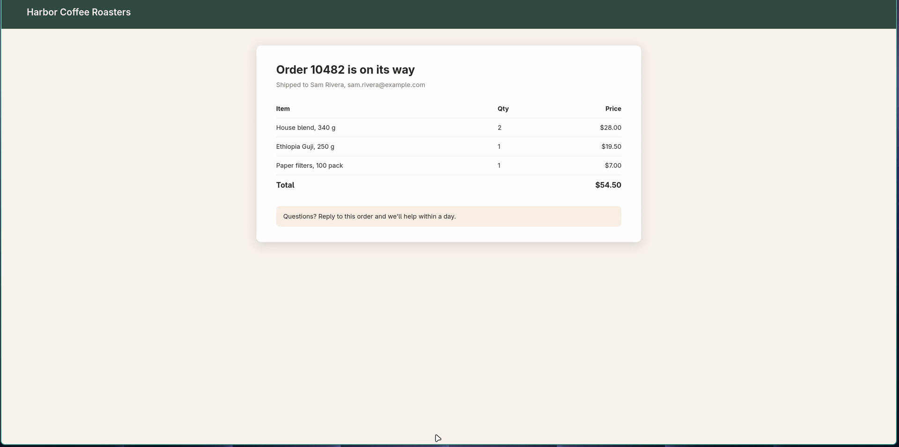
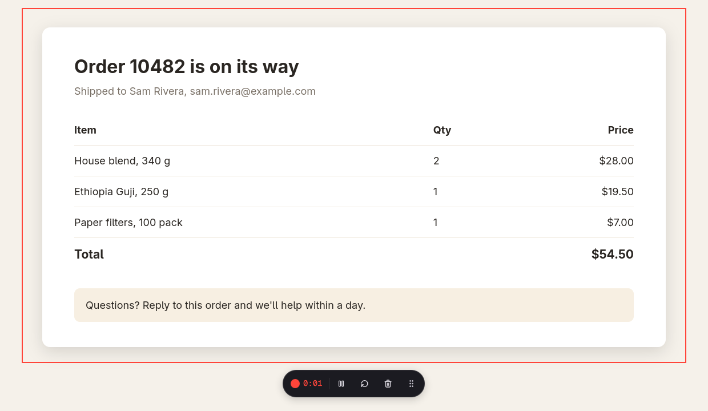
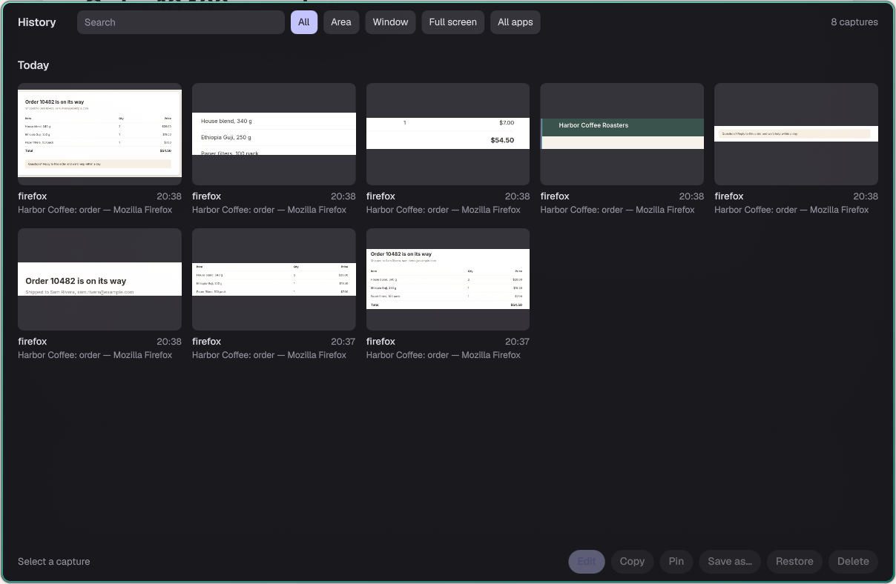
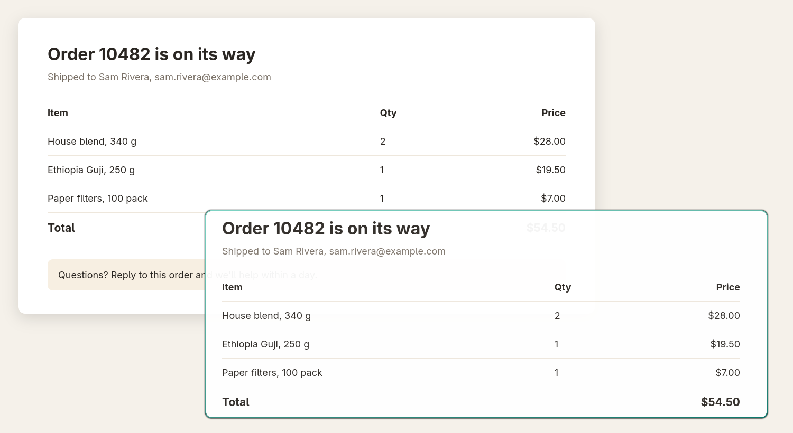

# Tarn

**Screenshots and screen recordings for Hyprland.**

Press a key, drag over part of the screen, and the shot lands as a small Thumbnail in the corner. From there, copy it, save it, pin it above your windows, or open it in an Editor to add arrows, numbered steps, blur and a framed background before you share it. Record an area as an MP4 or a GIF the same way, trim it, and paste it straight into a chat.

> A tarn is a small, still mountain lake that reflects whatever is above it. Tarn does the same for your screen.



| Recording a GIF | History | A Pin |
|---|---|---|
|  |  |  |

Tarn is built for [Hyprland](https://hypr.land) on Arch-family Linux (developed on CachyOS).

## What it does

**Capture**
- An Overlay on a frozen image of the screen: drag an area or click a window, with a Magnifier for pixel-exact edges and the size shown as you drag.
- Full screen, a Timer with a Countdown, and Last area to retake the same area of the same app.
- Sequence: take several Selections from the same frozen image.
- Text capture: copy the text in an area, or the contents of a QR code.
- Color pick: copy the color of any pixel.

**Record**
- An area or the full screen to MP4 or GIF, with the pointer, clicks shown as Ripples, and the microphone.
- A Recording bar outside the recorded area: stop, pause, restart, delete.
- Trim the start and end of a fresh Recording.

**Edit**
- Arrows (straight or curved), rectangles, ellipses, lines, text, emoji, a pencil, a Highlighter, Counters with Callouts, Pixelate and Spotlight. Every Annotation stays movable.
- Crop with ratio presets, rotate and flip.
- A Frame for sharing: gradient, wallpaper, blurred or plain Background, padding, shadow, corners, ratio, a Watermark, and saved Presets.

**Keep and share**
- A Thumbnail after every capture: Copy, Save, Pin or Edit.
- Pins: a capture floated above every window, which you can lock so clicks pass through it.
- History: every capture's untouched original, with its edits, for a month (you choose how long). Search by app, window title or the text in the shot.
- Colors that follow your desktop, if your shell or matugen writes a palette (see [Match your desktop's colors](#match-your-desktops-colors)).

## Install

### From the AUR

The [AUR](https://wiki.archlinux.org/title/Arch_User_Repository) is Arch's collection of community build recipes. An AUR helper such as `paru` or `yay` downloads Tarn's recipe, builds it on your machine and installs it with pacman:

```sh
paru -S tarn
```

That pulls in what Tarn needs to run: Qt 6, `grim` (takes the screenshots), `gpu-screen-recorder` (records), `ffmpeg` and `gifski` (make GIFs and trim) and `tesseract` (reads text). `zxing-cpp` (reads QR codes), `socat` and `jq` (for the Waybar example below) are optional; pacman lists them after the install.

### From source

```sh
sudo pacman -S --needed base-devel cmake ninja wayland-protocols \
    qt6-base qt6-declarative qt6-svg layer-shell-qt wayland tomlplusplus \
    grim libnotify gpu-screen-recorder ffmpeg gifski tesseract tesseract-data-eng
git clone https://github.com/rockylabsdev/tarn
cd tarn
cmake -B build -G Ninja -DCMAKE_BUILD_TYPE=Release -DCMAKE_INSTALL_PREFIX=/usr
cmake --build build
sudo cmake --install build
```

Optional: `zxing-cpp` for QR codes, and `socat` and `jq` for the Waybar example.

`gpu-screen-recorder` needs permission to read the screen. Arch's package grants it on install (it gives its helper `gsr-kms-server` the `cap_sys_admin` capability), so recording never asks for a password. Check it with `getcap /usr/bin/gsr-kms-server`.

`tarn --version` prints the version, for example `tarn 1.0.0`.

### Check your setup

```sh
tarn doctor
```

It checks Hyprland, the tools above, your graphics card's video encoder, and whether the Hyprland file below is loaded, and tells you which package to install for anything missing. Required items show `✓` or `✗`; optional ones show `✓` or `!`. It exits with 0 when everything required is in place, and 1 otherwise. A short run looks like this:

```
Required
✓ Hyprland: running
✓ grim: found
✓ gpu-screen-recorder: found
✓ Tarn's file: loaded (9 binds described "Tarn: …"; a changed key still counts)
✓ daemon: answering
Optional
✓ gifski: found (GIF Recordings)
✓ ffmpeg: found (GIF Recordings and Trim)
✓ tesseract: found (Text capture; languages: eng)
! ZXingReader: not found, so QR codes is off. Install: pacman -S zxing-cpp
✓ cursor:no_hardware_cursors = 0: hardware pointer, so captures leave the pointer out (information only)
Encoder
✓ encoder: hardware h264

Everything required is in place.
```

Run it after you have set up Hyprland below: before that, it reports Tarn's file and the daemon as missing.

## Set up Hyprland

Hyprland reads its settings from files written in [Lua](https://wiki.hypr.land/Configuring/Start/), a small scripting language (Hyprland 0.57 reads nothing else). You don't need to know Lua: you copy one file and add one line. Tarn ships a file of keyboard shortcuts and window rules, `tarn.lua`, that starts the Tarn daemon with Hyprland and adds the keys below. A package can't write into your home folder, so you copy it yourself:

```sh
mkdir -p ~/.config/hypr/config
cp /usr/share/doc/tarn/tarn.lua ~/.config/hypr/config/tarn.lua
```

Then open `~/.config/hypr/hyprland.lua`, your main Hyprland file, and add this line at the end. It tells Hyprland to load the file you just copied (`config.tarn` means the file `config/tarn.lua` next to it):

```lua
require("config.tarn")
```

Reload Hyprland with `hyprctl reload` (or log out and back in), and start the daemon for this session with `tarn daemon &`; from the next login on, the file starts it. Then run `tarn doctor`.

The file only adds; it never removes your own binds, and Hyprland runs both when two binds share a key. If `Print` already does something in your config, remove that bind or change Tarn's in your copy. Each bind in the file has a description that starts with `Tarn:` (for example `{ description = "Tarn: capture an area" }`). `tarn doctor` finds the file by those descriptions, so keep them on any bind you change or add.

| Key | What it does |
|---|---|
| `Print` | Overlay: drag an area or click a window |
| `Shift+Print` | The same area of the same app again, no Overlay |
| `Super+Print` | Full screen of the monitor under the pointer |
| `Super+Shift+Print` | Overlay with the Timer on |
| `Ctrl+Print` | Record an area; again to stop |
| `Ctrl+Shift+Print` | Text capture |
| `Alt+Print` | History window |
| `Super+Ctrl+Print` | Bring back the last closed Thumbnail |
| `Super+Shift+P` | Lock or unlock every Pin |

Inside the Overlay: `1` Screenshot, `2` Record, `3` Text, `4` Color, `T` Timer, `S` Sequence, `F` full screen, `L` last area, `M` Magnifier, `Esc` cancel. Hold `Ctrl` while you let go to adjust the Selection before taking it.

`Alt+Print` is bound by key code (`code:107`) because holding Alt turns the Print key into SysRq, and a bind on "Alt+Print" never fires. If it does nothing on your keyboard, run `wev`, press Print, and use the `keycode` it shows.

### One Hyprland option Tarn needs

```lua
-- in hyprland.lua
hl.config({ cursor = { no_hardware_cursors = 0 } })
```

This keeps the pointer out of your screenshots. Hyprland can draw the pointer two ways: as a *hardware* cursor (a separate layer the graphics card puts on top) or a *software* cursor (painted into the screen image). Tarn can only leave the pointer out of a shot, or draw it where you want in a Recording, when it's a hardware cursor. With a software cursor the pointer is part of every capture. Some NVIDIA setups need software cursors; Tarn still works there, with the pointer in every shot. `tarn doctor` reports which one you have.

## Settings

Tarn writes `~/.config/tarn/config.toml` with comments the first time it runs. `tarn settings` opens it. Changes apply as soon as you save; a mistake is reported with its line number, and that one Setting keeps its last good value.

| Setting | Default | What it does |
|---|---|---|
| `screenshot_folder` | `~/Pictures/Screenshots` | Where Save puts shots |
| `recordings_folder` | `~/Videos/Tarn` | Where Recordings are saved |
| `keep_history_for` | `"1 month"` | `"2 weeks"`, `"1 year"`, `"forever"`… |
| `copy_automatically` | `false` | Copy every capture as soon as it's taken |
| `save_automatically` | `false` | Save every capture as soon as it's taken |
| `close_thumbnail_after` | `0` | Seconds before a Thumbnail closes by itself; 0 never |
| `text_languages` | `"eng"` | Tesseract languages, joined with `+` (`"eng+fra"`); each needs its `tesseract-data-*` package |
| `show_pointer_in_recordings` | `true` | The pointer in Recordings (needs hardware cursors) |
| `wallpaper_folder` | `~/Pictures/Wallpapers` | Images offered as Frame Backgrounds |
| `wallpaper_file` | (empty) | A file holding the path of your current wallpaper |
| `file_name` | `"{date}_{time}_{app}"` | File names; tokens `{date}` `{time}` `{app}` `{title}` `{kind}` |
| `image_format` | `"png"` | `png`, `jpeg` or `webp` |
| `timer_delay` | `3` | The Timer's Countdown, in seconds; 0 takes the shot at once |
| `gif_max_width` | `1280` | A wider GIF is scaled down to this width; 0 keeps full size. The MP4 always keeps full size |
| `palette_file` | (empty) | A JSON file of your desktop's colors |
| `accent_color` | (empty) | A fixed accent color, such as `"#7aa2f7"`; wins over the palette |

## Make it fit your desktop

These are optional. Tarn looks right without them, in its own colors.

### Match your desktop's colors

Tarn reads a JSON file of [Material 3](https://m3.material.io/styles/color/roles) color names and follows it live. [matugen](https://github.com/InioX/matugen), which makes a color scheme from your wallpaper, can write it. Save this template as `~/.config/matugen/templates/tarn.json`:

```json
{
  "surface_container_lowest": "{{colors.surface_container_lowest.default.hex}}",
  "surface_container_low": "{{colors.surface_container_low.default.hex}}",
  "surface_container": "{{colors.surface_container.default.hex}}",
  "surface_container_high": "{{colors.surface_container_high.default.hex}}",
  "surface_container_highest": "{{colors.surface_container_highest.default.hex}}",
  "surface_bright": "{{colors.surface_bright.default.hex}}",
  "on_surface": "{{colors.on_surface.default.hex}}",
  "on_surface_variant": "{{colors.on_surface_variant.default.hex}}",
  "outline": "{{colors.outline.default.hex}}",
  "outline_variant": "{{colors.outline_variant.default.hex}}",
  "primary": "{{colors.primary.default.hex}}",
  "on_primary": "{{colors.on_primary.default.hex}}"
}
```

add it to `~/.config/matugen/config.toml`:

```toml
[templates.tarn]
input_path = "~/.config/matugen/templates/tarn.json"
output_path = "~/.local/state/tarn/palette.json"
```

and point Tarn at the output:

```toml
# ~/.config/tarn/config.toml
palette_file = "~/.local/state/tarn/palette.json"
```

Any tool can write this file instead. A missing color falls back to Tarn's own, and the file may also hold `accent` and `on_accent`, which win over `primary` and `on_primary`.

### Your current wallpaper as a Background

The Editor's Background panel offers your current wallpaper first. Tarn can't ask Hyprland which one that is, so have your wallpaper script write its path to a file (the first line of the file is the path):

```sh
# wherever you set the wallpaper, e.g. with swww
swww img "$img" && echo "$img" > ~/.local/state/tarn/wallpaper
```

```toml
# ~/.config/tarn/config.toml
wallpaper_file = "~/.local/state/tarn/wallpaper"
```

### Show a Recording in your bar

The Tarn daemon reports a running Recording on a socket (`$XDG_RUNTIME_DIR/tarn/shell.sock`), and a bar can show it and stop it. The protocol is in [docs/shell-socket.md](docs/shell-socket.md). For [Waybar](https://github.com/Alexays/Waybar), install `socat` and `jq`, copy the example script and add the module:

```sh
mkdir -p ~/.config/waybar
cp /usr/share/doc/tarn/waybar/tarn-recording.sh ~/.config/waybar/
```

```jsonc
// ~/.config/waybar/config.jsonc: add "custom/tarn" to a modules list, then
"custom/tarn": {
  "exec": "~/.config/waybar/tarn-recording.sh",
  "return-type": "json",
  "on-click": "~/.config/waybar/tarn-recording.sh stop"
}
```

It shows ● while recording, ⏸ while paused and `GIF 42%` while a GIF is made, and nothing otherwise. Click it to stop. Waybar also sets the state as a CSS class (`recording`, `paused` or `encoding`) on `#custom-tarn`, for styling.

## Limits

- **Hyprland only.** Tarn talks to Hyprland directly to find windows and monitors and to place its own. Other Wayland compositors aren't supported.
- **Recording needs a video encoder.** On a graphics card without one, Tarn records on the CPU instead, which is slower and works the processor hard. `tarn doctor` tells you which you have.
- **Pinned windows sit under a fullscreen window**, because Hyprland's `binds:allow_pin_fullscreen` is off by default.
- **Copy keeps a file for a day.** The clipboard holds a file from Tarn's cache, swept after a day, so a paste of a day-old Copy can find nothing.
- **The Overlay and a full-screen shot cover one monitor at a time**, the one under the pointer.
- **Small or high-scale monitors.** A stack of four Thumbnails needs 652 logical pixels of height, so with less free height (for example 1080p at 2x with bars) the top card is off the screen. The Editor is at least 1180 logical pixels wide, so on a monitor narrower than that (1080p at 2x) it is wider than the screen.
- **One Thumbnail stack.** Thumbnails and the Recording bar are placed per monitor, but the stack follows the newest capture: cards from an earlier capture on the other monitor move with it.
- **Recording on mixed scales is untested.** Tarn sends the recorder an area in the target monitor's pixels, and how the recorder reads that on a desktop whose monitors have different scales hasn't been tried.
- **Not measured.** Compositor frame time, hardware video encoding and start-up on a laptop's integrated graphics.

## Planned

- [**Scrolling capture**](https://github.com/rockylabsdev/tarn/issues/1): one tall shot of a page longer than the screen.
- [**Recording Editor**](https://github.com/rockylabsdev/tarn/issues/2): Recordings as editable projects, with zooms, pointer styling and keystrokes.

## How it's built

Tarn is a C++ and Qt Quick program ([why](docs/adr/0001-qt6-cpp-qml-own-program.md)). A daemon starts with Hyprland and owns every surface, so the Overlay opens in a few milliseconds; the `tarn` command only sends it a request. It calls `grim` for screenshots, `gpu-screen-recorder` for video, `gifski` for GIFs and `tesseract` for text.

- [docs/agents/map.md](docs/agents/map.md): which module does what, and the path a capture takes through them.
- [docs/adr/](docs/adr/): the decisions that would be hard to undo, and why.
- [GLOSSARY.md](GLOSSARY.md): what Tarn's words (Overlay, Thumbnail, Pin, Frame…) mean.
- [docs/hyprland.md](docs/hyprland.md) and [docs/recording.md](docs/recording.md): the Hyprland and recorder behavior Tarn depends on, measured.

Tarn was planned and built with AI coding agents, and the planning is all public: the issues hold every spec and decision, and [CONTRIBUTING.md](CONTRIBUTING.md) explains how it's organized and how to help.

## Credits

- Island, the author's Quickshell shell, the reference client.
- Tarn runs [grim](https://gitlab.freedesktop.org/emersion/grim), [gpu-screen-recorder](https://git.dec05eba.com/gpu-screen-recorder/about/), [gifski](https://gif.ski), [FFmpeg](https://ffmpeg.org), [Tesseract](https://github.com/tesseract-ocr/tesseract) and [zxing-cpp](https://github.com/zxing-cpp/zxing-cpp). Bundled assets and their licenses: [THIRD-PARTY.md](THIRD-PARTY.md).

## License

[MIT](LICENSE).
